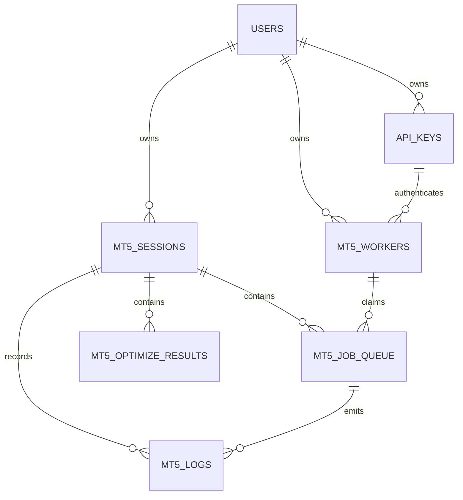

# Kế hoạch thiết kế lại MT5 Optimization theo Session

> Cập nhật 28/09/2026: thiết kế 6 bảng trong tài liệu này đã được nâng lên 8 bảng bằng cách tách `mt5_backtest_candidates` và `mt5_backtest_staging`. Chi tiết mới nằm tại `mt5-optimization-candidate-staging-split-plan.md` và được ưu tiên khi có nội dung khác nhau.

## 1. Mục tiêu

Thiết kế này xây mới hoàn toàn phần MT5 Optimization. Nhánh `backtest_be`, `backtest_fe` và tài liệu `mt5-optimization-legacy-archive.md` chỉ được dùng để rút kinh nghiệm về luồng nghiệp vụ, recovery, cleanup và giao diện; không sao chép lại cấu trúc database cũ.

Các mục tiêu bắt buộc:

- Đơn giản hóa database còn đúng 6 bảng thuộc module.
- Session là phạm vi nghiệp vụ chính: một user có thể tạo nhiều session.
- `job_id` chỉ nhận diện một lần thực thi trong hàng đợi; kết quả nghiệp vụ không phụ thuộc vào `job_id`.
- Lưu toàn bộ pass Open Price MT5 trả về, chỉ bỏ pass có toàn bộ metrics kết quả bằng 0.
- Không còn core gate, OTM filter, cluster, fallback hoặc refilter trong bước nhập kết quả Open Price.
- Một dòng kết quả có thể đi xuyên suốt Open Price -> Watchlist/Candidate -> Every Tick -> Staging -> Sync.
- Mỗi strategy trong một session chỉ được có tối đa một candidate đang được chọn vào Backtest Staging.
- Worker có lease, heartbeat, retry và recovery sau restart/redeploy.
- Danh sách lớn phải phân trang và không tải `deals` trong API danh sách.

## 2. Những điểm không được lặp lại từ thiết kế cũ

- Không tạo nhiều bảng phụ cho config, OTM request, candidate selection, Open Price result, Every Tick result và auto batch nếu cùng một vòng đời có thể biểu diễn bằng một dòng kết quả.
- Không dùng `job_id` làm khóa nghiệp vụ của candidate hoặc làm điều kiện để tìm kết quả về sau.
- Không lưu cùng một bộ tham số ở nhiều bảng kết quả khác nhau.
- Không dùng artifact vật lý làm nguồn dữ liệu lâu dài cho tải INI, rerun hoặc Every Tick.
- Không tính Passed/Core Gate tự động cho hàng nghìn strategy khi mở trang.
- Không để frontend tải toàn bộ candidate hoặc `deals` chỉ để dựng bảng summary.
- Không ghi từng heartbeat hoặc từng dòng stdout của worker vào PostgreSQL.
- Không cho một request mở quá nhiều query song song hoặc chiếm hết PostgreSQL pool.

Các cơ chế tốt từ bản cũ vẫn được giữ về nguyên tắc:

- Worker claim job atomically.
- Heartbeat và lease để thu hồi job bị treo.
- Mỗi lần claim có `run_id` riêng để chặn callback cũ.
- Upload payload lớn theo chunk.
- Cleanup chỉ xóa tài nguyên của execution đã kết thúc.
- UI hiển thị dần và mỗi vùng có loading độc lập.
- Worker public có thể chạy job của user khác nhưng không đổi owner của job/session/result.

## 3. Sáu bảng của module mới

| Bảng | Trách nhiệm duy nhất |
| --- | --- |
| `mt5_sessions` | Không gian làm việc do user sở hữu |
| `api_keys` | API key dùng chung cho worker và các chức năng tích hợp về sau |
| `mt5_workers` | Danh tính worker, heartbeat, khả năng chạy và chế độ chia sẻ |
| `mt5_job_queue` | Hàng đợi thực thi Open Price/Every Tick |
| `mt5_optimize_results` | Toàn bộ pass Open Price và kết quả Every Tick tương ứng |
| `mt5_logs` | Event/audit log gọn cho session, job và worker |

Bảng thứ sáu là `mt5_workers`. Không nên gộp worker vào `api_keys` vì một API key có thể được rotate hoặc dùng cho nhiều mục đích, trong khi worker có heartbeat, trạng thái online, capability và sharing riêng.

Các bảng có sẵn ngoài module và được tham chiếu:

- `users`: owner của session, key, worker và job.
- `data_source`: registry xác thực quyền truy cập bảng backtest đích.
- Các bảng động `backtest*`: chỉ được ghi sau bước Sync tại Backtest Staging.

## 4. Quan hệ tổng quát



Chủ ý không có quan hệ từ `mt5_optimize_results` tới `mt5_job_queue`.

- Open Price job chỉ insert các result mới; `strategy_id_r` được sinh từ khóa số của chính result, không lấy từ job.
- Every Tick job mang `strategy_id_r` trong payload thực thi và cập nhật đúng result theo `session_id + strategy_id_r`.
- Xóa lịch sử queue không được xóa kết quả đã nhập.
- Rerun Open Price tạo job mới và insert result mới; rerun Every Tick cập nhật `summary_bt + deals` của đúng `strategy_id_r` được chọn.

## 5. Quy ước khóa

### 5.1. Khóa kỹ thuật

- Session, worker, job và `run_id`: UUID do Node.js tạo bằng `crypto.randomUUID()`.
- Các bảng dữ liệu khối lượng lớn (`mt5_optimize_results`, `mt5_logs`): `BIGSERIAL` làm khóa chính để index gọn và insert nhanh.
- User ID giữ nguyên kiểu `INTEGER` để khớp bảng `users` hiện tại.

### 5.2. Khóa nghiệp vụ kết quả

- `strategy_id`: mã strategy gốc, ví dụ `001BTCUSDH1`.
- `id`: số `BIGSERIAL` tăng tự động và không lặp.
- `strategy_id_r`: mã duy nhất của bộ tham số, được tạo bằng `strategy_id + '_' + id`, ví dụ `001BTCUSDH1_1001`.
- Unique bắt buộc: `strategy_id_r`.
- Không đưa `job_id` vào `strategy_id_r`.

Quy ước cho bản đầu tiên:

- Rerun optimization chỉ insert thêm result mới và nhận các số `id` tiếp theo; không có ký hiệu `R1/R2` và không ghi đè lượt trước.
- `summary_op.pass` giữ số Pass nguyên bản MT5 trả về để đối chiếu, không dùng làm khóa và không dùng để đếm tổng result.
- Retry/finalize lại cùng một execution không được insert lần hai; queue row được khóa và đánh dấu hoàn tất trong cùng transaction ingest.
- Nếu user muốn tách hẳn hai chiến dịch nghiệp vụ độc lập thì tạo session mới; không cần thêm bảng campaign.

## 6. Schema đề xuất

DDL dưới đây là bản thiết kế mục tiêu. Chưa chạy migration trong giai đoạn duyệt plan.

### 6.1. `mt5_sessions`

```sql
CREATE TABLE mt5_sessions (
  id UUID PRIMARY KEY,
  user_id INTEGER NOT NULL REFERENCES users(id) ON DELETE CASCADE,
  name VARCHAR(160) NOT NULL,
  description TEXT,
  status VARCHAR(20) NOT NULL DEFAULT 'ACTIVE'
    CHECK (status IN ('ACTIVE', 'ARCHIVED')),
  created_at TIMESTAMPTZ NOT NULL DEFAULT NOW(),
  updated_at TIMESTAMPTZ NOT NULL DEFAULT NOW(),
  archived_at TIMESTAMPTZ,
  UNIQUE (id, user_id)
);

CREATE INDEX idx_mt5_sessions_user_updated
  ON mt5_sessions(user_id, updated_at DESC);
```

Session không bị đánh dấu `DONE` chỉ vì một đợt job hoàn thành. Nó là workspace để user tiếp tục Open Price, chọn candidate, chạy Every Tick và staging.

### 6.2. `api_keys`

```sql
CREATE TABLE api_keys (
  id BIGSERIAL PRIMARY KEY,
  user_id INTEGER NOT NULL REFERENCES users(id) ON DELETE CASCADE,
  name VARCHAR(120) NOT NULL,
  api_key VARCHAR(255) NOT NULL UNIQUE,
  scopes TEXT[] NOT NULL DEFAULT ARRAY['mt5:worker'],
  status VARCHAR(20) NOT NULL DEFAULT 'ACTIVE'
    CHECK (status IN ('ACTIVE', 'REVOKED')),
  expires_at TIMESTAMPTZ,
  last_used_at TIMESTAMPTZ,
  created_at TIMESTAMPTZ NOT NULL DEFAULT NOW(),
  revoked_at TIMESTAMPTZ,
  UNIQUE (user_id, name)
);

CREATE INDEX idx_api_keys_user_status
  ON api_keys(user_id, status);
```

`api_key` được lưu plaintext vì đây là web nội bộ, cho phép user xem và copy lại key bất kỳ lúc nào. Backend xác thực bằng cách so khớp đúng key đang active. Tên bảng và `scopes` vẫn được thiết kế tổng quát để sau này không chỉ phục vụ MT5.

### 6.3. `mt5_workers`

```sql
CREATE TABLE mt5_workers (
  id BIGSERIAL PRIMARY KEY,
  owner_user_id INTEGER NOT NULL REFERENCES users(id) ON DELETE CASCADE,
  owner_username VARCHAR(255) NOT NULL,
  api_key_id BIGINT REFERENCES api_keys(id) ON DELETE SET NULL,
  worker_name VARCHAR(160) NOT NULL,
  status VARCHAR(20) NOT NULL DEFAULT 'OFFLINE'
    CHECK (status IN ('OFFLINE', 'ONLINE', 'BUSY', 'DRAINING', 'BLOCKED')),
  run_access BOOLEAN NOT NULL DEFAULT TRUE,
  is_public BOOLEAN NOT NULL DEFAULT FALSE,
  allowed_job_types TEXT[] NOT NULL DEFAULT ARRAY['OPEN_PRICE', 'EVERY_TICK'],
  capabilities JSONB NOT NULL DEFAULT '{}'::jsonb,
  last_seen_at TIMESTAMPTZ,
  created_at TIMESTAMPTZ NOT NULL DEFAULT NOW(),
  updated_at TIMESTAMPTZ NOT NULL DEFAULT NOW(),
  UNIQUE (owner_user_id, worker_name)
);

CREATE INDEX idx_mt5_workers_dispatch
  ON mt5_workers(status, run_access, is_public, last_seen_at DESC);
```

Không lưu `current_job_id` trong worker. Current Job và Jobs Claimed trên giao diện được truy vấn từ queue/log, tránh hai nơi cùng giữ trạng thái và bị lệch nhau.

### 6.4. `mt5_job_queue`

```sql
CREATE TABLE mt5_job_queue (
  job_id UUID PRIMARY KEY,
  session_id UUID NOT NULL,
  user_id INTEGER NOT NULL,
  job_type VARCHAR(24) NOT NULL
    CHECK (job_type IN ('OPEN_PRICE', 'EVERY_TICK')),
  status VARCHAR(24) NOT NULL DEFAULT 'PENDING'
    CHECK (status IN ('PENDING', 'CLAIMED', 'RUNNING', 'DONE', 'FAILED', 'CANCELLED')),
  priority INTEGER NOT NULL DEFAULT 0,
  strategy_id VARCHAR(160),
  target_strategy_id_r VARCHAR(220),
  ini_content TEXT NOT NULL,
  job_payload JSONB NOT NULL DEFAULT '{}'::jsonb,
  input_artifact_path TEXT,
  claimed_by_worker_id BIGINT REFERENCES mt5_workers(id) ON DELETE SET NULL,
  run_id UUID,
  attempt_count INTEGER NOT NULL DEFAULT 0 CHECK (attempt_count >= 0),
  max_attempts INTEGER NOT NULL DEFAULT 3 CHECK (max_attempts > 0),
  progress SMALLINT NOT NULL DEFAULT 0 CHECK (progress BETWEEN 0 AND 100),
  lease_expires_at TIMESTAMPTZ,
  heartbeat_at TIMESTAMPTZ,
  error_code VARCHAR(80),
  error_message TEXT,
  created_at TIMESTAMPTZ NOT NULL DEFAULT NOW(),
  started_at TIMESTAMPTZ,
  finished_at TIMESTAMPTZ,
  updated_at TIMESTAMPTZ NOT NULL DEFAULT NOW(),
  FOREIGN KEY (session_id, user_id)
    REFERENCES mt5_sessions(id, user_id) ON DELETE CASCADE
);

CREATE INDEX idx_mt5_queue_claim
  ON mt5_job_queue(status, job_type, priority DESC, created_at)
  WHERE status = 'PENDING';

CREATE INDEX idx_mt5_queue_session_created
  ON mt5_job_queue(session_id, created_at DESC);

CREATE INDEX idx_mt5_queue_worker_active
  ON mt5_job_queue(claimed_by_worker_id, status)
  WHERE status IN ('CLAIMED', 'RUNNING');

CREATE UNIQUE INDEX uq_mt5_queue_active_run
  ON mt5_job_queue(run_id)
  WHERE run_id IS NOT NULL;
```

Ý nghĩa:

- Queue chỉ lưu dữ liệu cần để thực thi và theo dõi job.
- `job_id` là định danh cố định của job và không đổi khi retry; `run_id` được tạo mới sau mỗi lần worker claim.
- `target_strategy_id_r` chỉ là mục tiêu của Every Tick job trong queue, không phải khóa của result và không được chép sang result dưới dạng `job_id`.
- `ini_content` là nội dung INI chuẩn để có thể dựng lại artifact.
- `job_payload` chứa cấu hình execution như model, date range, optimize runs và manifest; không chứa toàn bộ result.
- `input_artifact_path` là tài nguyên tạm và được cleanup sau khi job terminal.
- Các job được nối tiếp trực tiếp trong queue theo `session_id + created_at`. Một lần thêm 200 strategy rồi thêm 300 strategy chỉ tạo thêm 300 dòng phía sau, không tạo khái niệm batch trong database.

### 6.5. `mt5_optimize_results`

```sql
CREATE TABLE mt5_optimize_results (
  id BIGSERIAL PRIMARY KEY,
  session_id UUID NOT NULL,
  user_id INTEGER NOT NULL,
  strategy_id VARCHAR(160) NOT NULL,
  strategy_id_r VARCHAR(220)
    GENERATED ALWAYS AS (strategy_id || '_' || id::TEXT) STORED,
  summary_op JSONB NOT NULL,
  picked_watchlist BOOLEAN NOT NULL DEFAULT FALSE,
  picked_bt BOOLEAN NOT NULL DEFAULT FALSE,
  picked_bt_staging BOOLEAN NOT NULL DEFAULT FALSE,
  summary_bt JSONB,
  deals JSONB,
  backtest_completed_at TIMESTAMPTZ,
  staging_target_table VARCHAR(255),
  source_table VARCHAR(255),
  sync_status VARCHAR(20) NOT NULL DEFAULT 'NOT_SYNCED'
    CHECK (sync_status IN ('NOT_SYNCED', 'SYNCING', 'SYNCED', 'SYNC_FAILED')),
  synced_at TIMESTAMPTZ,
  created_at TIMESTAMPTZ NOT NULL DEFAULT NOW(),
  updated_at TIMESTAMPTZ NOT NULL DEFAULT NOW(),
  FOREIGN KEY (session_id, user_id)
    REFERENCES mt5_sessions(id, user_id) ON DELETE CASCADE,
  UNIQUE (strategy_id_r),
  CHECK (
    (summary_bt IS NULL AND deals IS NULL AND backtest_completed_at IS NULL)
    OR
    (summary_bt IS NOT NULL AND deals IS NOT NULL AND backtest_completed_at IS NOT NULL)
  ),
  CHECK (NOT picked_bt_staging OR summary_bt IS NOT NULL),
  CHECK (NOT picked_bt_staging OR picked_bt = TRUE),
  CHECK (
    (sync_status = 'SYNCED' AND source_table IS NOT NULL AND synced_at IS NOT NULL)
    OR
    (sync_status <> 'SYNCED' AND source_table IS NULL AND synced_at IS NULL)
  )
);

CREATE INDEX idx_mt5_results_session_strategy
  ON mt5_optimize_results(session_id, strategy_id, id);

CREATE INDEX idx_mt5_results_watchlist
  ON mt5_optimize_results(session_id, updated_at DESC)
  WHERE picked_watchlist = TRUE;

CREATE INDEX idx_mt5_results_bt_candidates
  ON mt5_optimize_results(session_id, updated_at DESC)
  WHERE picked_bt = TRUE;

CREATE INDEX idx_mt5_results_staging
  ON mt5_optimize_results(session_id, updated_at DESC)
  WHERE picked_bt_staging = TRUE;

CREATE UNIQUE INDEX uq_mt5_one_staging_result_per_strategy
  ON mt5_optimize_results(session_id, strategy_id)
  WHERE picked_bt_staging = TRUE;
```

Quy tắc dữ liệu:

- `summary_op`: payload Open Price duy nhất theo cấu trúc canonical `{ "pass": ..., "inputs": {...}, "metrics": {...} }`.
- `summary_op.inputs`: toàn bộ bộ tham số dùng để dựng INI cho Every Tick/rerun.
- `summary_op.metrics`: toàn bộ chỉ số kết quả Open Price MT5 trả về.
- `summary_op.pass`: số Pass nguyên bản MT5 trả về; có thể lặp lại khi rerun và không phải tổng số bộ tham số.
- `strategy_id_r` dùng `id BIGSERIAL` làm hậu tố nên mỗi lần rerun chỉ nối thêm số mới, không cần `optimization_run`.
- `picked_watchlist`: user muốn theo dõi kết quả, độc lập với việc chạy Every Tick.
- `picked_bt`: user chọn result để chạy Every Tick.
- `summary_bt` và `deals`: ban đầu null; được ghi cùng transaction sau Every Tick thành công. `summary_bt` có cấu trúc canonical `{ "settings": {...}, "results": {...} }`; hai object phải có dữ liệu và `deals` phải là mảng có ít nhất một deal.
- Every Tick thiếu Settings, Results hoặc deals được coi là `NO_DATA`: không cập nhật ba cột `summary_bt`, `deals`, `backtest_completed_at`.
- `picked_bt_staging`: chỉ bật sau khi đã có Every Tick; unique partial index đảm bảo tối đa một result staging cho mỗi strategy trong session.
- `staging_target_table`: tên bảng đích đã chọn. Service bắt buộc kiểm tra nó tồn tại, bắt đầu bằng `backtest` và user có quyền qua `data_source` trước khi sync.
- `source_table`: bảng backtest đã thực sự nhận bộ tham số và dữ liệu Every Tick hiện tại. Trước khi sync thành công, cột này luôn null.
- `sync_status = SYNCED`, `source_table` và `synced_at` chỉ được ghi cùng nhau sau khi transaction ghi bảng backtest đích đã commit.
- Khi chạy Every Tick thành công lần mới, dữ liệu hiện tại chưa còn đồng bộ với bản đã ghi trước đó; phải reset `picked_bt_staging = false`, `staging_target_table = null`, `source_table = null`, `sync_status = 'NOT_SYNCED'` và `synced_at = null`.

`deals` có thể rất lớn nhưng vẫn được giữ trong cùng bảng theo yêu cầu đơn giản hóa. Để tránh bloat và tải chậm:

- API list tuyệt đối không `SELECT deals`.
- Chỉ endpoint detail/export/sync mới đọc `deals` của đúng một result.
- Không tạo GIN index cho `deals`.
- Update selection chỉ sửa các cột cờ, không ghi lại `summary_op`, `summary_bt` và `deals`.
- Theo dõi kích thước TOAST. Nếu một result thường xuyên vượt ngưỡng dung lượng đã thống nhất sau đo thực tế, việc tách deals thành bảng thứ bảy phải được duyệt như một thay đổi kiến trúc riêng.

### 6.6. `mt5_logs`

```sql
CREATE TABLE mt5_logs (
  id BIGSERIAL PRIMARY KEY,
  session_id UUID REFERENCES mt5_sessions(id) ON DELETE CASCADE,
  user_id INTEGER REFERENCES users(id) ON DELETE SET NULL,
  job_id UUID REFERENCES mt5_job_queue(job_id) ON DELETE SET NULL,
  worker_id BIGINT REFERENCES mt5_workers(id) ON DELETE SET NULL,
  level VARCHAR(16) NOT NULL
    CHECK (level IN ('INFO', 'WARN', 'ERROR')),
  event_type VARCHAR(80) NOT NULL,
  message TEXT NOT NULL,
  context JSONB NOT NULL DEFAULT '{}'::jsonb,
  created_at TIMESTAMPTZ NOT NULL DEFAULT NOW()
);

CREATE INDEX idx_mt5_logs_session_created
  ON mt5_logs(session_id, created_at DESC);

CREATE INDEX idx_mt5_logs_job_created
  ON mt5_logs(job_id, created_at DESC)
  WHERE job_id IS NOT NULL;

CREATE INDEX idx_mt5_logs_errors
  ON mt5_logs(created_at DESC)
  WHERE level = 'ERROR';
```

Chỉ ghi event có giá trị audit/diagnostic như created, claimed, started, completed, failed, retried, cancelled, result ingested, candidate picked và synced. Heartbeat và progress liên tục chỉ update queue; raw stdout của worker ở file/observability, không insert từng dòng vào PostgreSQL.

## 7. Quy tắc loại pass toàn 0

Không dùng điều kiện profit > 0, trades > 0 hoặc core gate cũ.

Một pass chỉ bị loại khi tất cả metrics trong `summary_op.metrics` thuộc danh sách chuẩn đều là `0`, null, chuỗi rỗng hoặc không parse được. `summary_op.inputs` không tham gia điều kiện này.

Danh sách metrics chuẩn ban đầu phải lấy từ parser Open Price, ví dụ:

- result/profit
- total trades/deals
- expected payoff
- drawdown amount và drawdown percent
- profit factor
- recovery factor
- Sharpe ratio

Nếu chỉ một metric có giá trị khác 0 thì vẫn lưu pass. Backend phải trả và log tổng số `received`, `inserted`, `updated`, `skipped_all_zero`, `invalid` cho mỗi upload chunk/finalize.

## 8. Luồng nghiệp vụ mới

### 8.1. Tạo API key và worker

1. User tạo API key có scope `mt5:worker`.
2. Worker gửi key và identity khi heartbeat.
3. Backend so khớp API key plaintext đang active, upsert `mt5_workers` và cập nhật `last_seen_at`.
4. Worker private chỉ claim job cùng owner.
5. Worker public có thể claim job user khác; `user_id` của queue, session và result vẫn là user tạo job.

### 8.2. INI Config

1. User upload folder bot và cấu hình INI.
2. Frontend/backend tạo ZIP như luồng đã kiểm chứng ở module INI Config.
3. Nội dung INI cần thiết được lưu vào queue khi tạo job.
4. ZIP là artifact thực thi tạm, không phải source of truth dài hạn.

### 8.3. Tạo Session

1. User tạo session và đặt tên.
2. Session dropdown chỉ hiển thị session user sở hữu; admin có thể xem theo quyền quản trị.
3. Mọi tab Optimize bắt buộc có `session_id` hiện hành.
4. Đổi session phải hủy request cũ và tải lại đúng dữ liệu session mới.

### 8.4. Open Price

1. User upload bundle tại Jobs Queue Process.
2. Backend tạo một queue job cho mỗi strategy trong `session_id`; các lần upload sau chỉ nối thêm job mới vào queue.
3. Worker claim bằng transaction và lease.
4. Worker chạy Open Price, upload kết quả theo chunk.
5. Backend parse và bulk insert vào `mt5_optimize_results`; PostgreSQL cấp `id` và sinh `strategy_id_r` cho từng dòng.
6. Chỉ bỏ pass toàn 0; không filter, rank, cluster hay core gate.
7. Finalize thành công mới chuyển queue job sang `DONE`.

### 8.5. All Optimize Results

1. Chỉ tải summary theo session bằng cursor/keyset pagination.
2. User bật/tắt `picked_watchlist` để đưa vào My OTM Watchlist.
3. User bật/tắt `picked_bt` để đưa vào All Backtest Candidates và cho phép tạo Every Tick job.
4. Hai lựa chọn độc lập; không cần tạo bảng selection riêng.
5. Có thể filter/sort theo trường trong `summary_op`, nhưng filter chỉ ảnh hưởng view, không xóa result khỏi database.

### 8.6. Every Tick và All Backtest Candidates

1. User chọn một hoặc nhiều result có `picked_bt = true`.
2. Backend tạo `EVERY_TICK` queue job với `target_strategy_id_r` và snapshot INI/payload cần chạy.
3. Worker chạy Every Tick và upload `summary_bt + deals`.
4. Backend kiểm tra Settings, Results và deals đều có dữ liệu; payload rỗng bị từ chối và không ghi result.
5. Backend khóa đúng result bằng `SELECT ... FOR UPDATE`, xác nhận session/user/strategy key rồi cập nhật cả hai payload trong một transaction.
6. Queue job hoàn thành không tạo result row mới.
7. UI All Backtest Candidates chỉ hiển thị các result `picked_bt = true`, phân biệt rõ Waiting, Running, Done và Failed từ queue hiện hành.

### 8.7. Backtest Staging và Sync

1. Trong các result đã Every Tick xong, user chọn một result đại diện cho mỗi strategy.
2. Transaction tắt `picked_bt_staging` của result cũ rồi bật result mới.
3. Partial unique index chặn race condition tạo hai result staging cùng strategy/session.
4. User chọn backtest table đích.
5. Backend kiểm tra quyền bằng `data_source.owner_user_id`; không nối trực tiếp tới bảng động bằng foreign key.
6. Khi user bấm Sync, backend ghi metadata/deals vào bảng đích theo transaction hiện hành của module backtest.
7. Chỉ sau commit mới cập nhật `source_table = staging_target_table`, `sync_status = 'SYNCED'` và `synced_at` trên từng result đã sync.
8. Nếu strategy đã tồn tại trong đúng bảng đích, frontend phải xác nhận ghi đè. Việc tồn tại ở bảng backtest khác không phải conflict.

## 9. State machine

### Queue

```text
PENDING -> CLAIMED -> RUNNING -> DONE
                    |       
                    +-------> FAILED -> PENDING (retry/requeue)
PENDING/CLAIMED/RUNNING -> CANCELLED
```

Quy tắc:

- Worker claim bằng `FOR UPDATE SKIP LOCKED`.
- Claim sinh `run_id` mới, tăng `attempt_count`, đặt lease.
- Callback chỉ hợp lệ khi `id + run_id + claimed_by_worker_id` khớp và status đang active.
- Job quá lease được sweeper đưa về `PENDING` nếu còn attempt, nếu không chuyển `FAILED`.
- Stop Now chuyển `CANCELLED`; callback đến muộn không được ghi result/finalize job.

### Result

```text
Open Price stored
  -> picked_watchlist (tùy chọn)
  -> picked_bt
  -> summary_bt + deals completed
  -> picked_bt_staging
  -> synced to selected backtest table
```

Các cờ thể hiện lựa chọn độc lập, không phải status tuyến tính duy nhất.

## 10. API tổng quát cần xây sau khi duyệt schema

### Session

- Create/list/update/archive session.
- Mọi endpoint list/result/job nhận `session_id` và kiểm tra ownership ở service.

### API key và worker

- Create/list/revoke key.
- Worker verify/heartbeat/claim/progress/done/fail.
- User đổi public/private, run access và allowed job type.

### Queue

- Upload/split bundle thành jobs.
- List job theo session với pagination.
- Stop, retry, requeue và xóa lịch sử job.
- Upload Open Price/Every Tick theo chunk và finalize idempotent.

### Result

- List Open Price metrics; detail đọc `summary_op.inputs` và `summary_op.metrics`.
- Toggle watchlist và backtest candidate theo result IDs.
- Create Every Tick jobs từ result IDs.
- List Backtest Candidates.
- Chọn đúng một staging result cho mỗi strategy.
- Sync staging result vào backtest table đích.

Không endpoint list nào trả `deals`. Endpoint detail deals phải lấy đúng một `result id` hoặc `strategy_id_r` thuộc session.

## 11. Mapping giao diện

### Setup Workers

- Bảng `mt5_workers` kết hợp owner từ `users` và prefix key từ `api_keys`.
- Current Job truy vấn queue active, không lưu lặp trong worker.
- Jobs Claimed được tổng hợp từ queue/log; không phải counter bắt buộc trong worker.

### INI Config

- Giữ luồng tạo ZIP hiện tại đã được kiểm chứng.
- Chưa cần phụ thuộc database MT5 ngoài việc tạo queue job ở bước upload.

### Optimize / Jobs Queue Process

- Session hiện hành là bắt buộc.
- Hiển thị queue theo trang; row nào trả về trước hiển thị trước.
- Stop/retry thao tác đúng job execution.

### Optimize / All Optimize Results

- Nguồn duy nhất là `mt5_optimize_results.summary_op`.
- Có Watchlist và Pick for Backtest.
- Không hiển thị Passed/Core Gate cũ nếu chưa có một nghiệp vụ mới được duyệt.

### Optimize / All Backtest Candidates

- Chỉ lấy `picked_bt = true`.
- Sau Every Tick dùng `summary_bt`; chi tiết deal chỉ tải khi mở.
- Cho phép chạy lại Every Tick mà không tạo candidate/result mới.

### Optimize / Backtest Staging

- Chỉ lấy `picked_bt_staging = true`.
- Mỗi strategy một dòng đại diện trong session.
- Chọn bảng đích từ danh sách `data_source` user được phép truy cập.

### TPL Generator

- Độc lập với schema kết quả; chỉ dùng API key/session nếu về sau nghiệp vụ thực sự yêu cầu.

## 12. Hiệu năng và khả năng mở rộng

- Insert result theo chunk, ưu tiên `COPY` vào staging memory/temporary flow hoặc multi-row insert có giới hạn; không insert từng pass tuần tự.
- Upload lớn theo chunk có `upload_id`, chunk index và checksum trong payload/temporary storage; finalize phải idempotent.
- List dùng keyset pagination theo `id`, không dùng OFFSET sâu cho hàng triệu result.
- Chỉ select `summary_op.metrics` và các cột cần hiển thị; `summary_op.inputs`, `summary_bt` và đặc biệt `deals` tải theo nhu cầu.
- Các filter JSONB thường dùng phải có expression index riêng sau khi chốt tên key canonical. Không tạo index cho mọi key.
- Chuẩn hóa tên key JSON và kiểu số ngay khi ingest; frontend không tự đoán nhiều alias.
- Giới hạn concurrency ingest và Every Tick finalize; không dùng `Promise.all` không giới hạn.
- Chừa connection pool cho dashboard/backtest; worker HTTP không giữ DB connection trong lúc MT5 đang chạy.
- Query list/detail có statement timeout riêng; abort request phải giải phóng query khi khả thi.
- Log chỉ là event, không phải stream từng dòng, để tránh bảng log phình theo heartbeat.

## 13. Transaction và tính đúng đắn

- Tạo session/job/result luôn gắn đúng `user_id`; composite FK chặn job/result trỏ session của user khác.
- Toggle cờ selection cập nhật đúng result ID và session trong một statement.
- Chọn staging dùng transaction và row lock theo `session_id + strategy_id`.
- Finalize Open Price chỉ đánh job DONE sau khi toàn bộ chunk đã ingest và tổng count khớp.
- Finalize Every Tick cập nhật result và job DONE trong cùng transaction DB.
- Sync backtest cập nhật dữ liệu đích trước; chỉ ghi `source_table` và đánh `SYNCED` sau commit.
- Finalize phải khóa queue row theo `job_id + run_id`; chỉ execution chưa hoàn tất mới được insert result và chuyển job sang DONE trong cùng transaction, nhờ đó retry response không tạo duplicate.
- Không thay đổi công thức metrics khi ingest: lưu đúng giá trị MT5 trả về trong JSON canonical; mọi metric tự tính bổ sung phải có tên riêng và tài liệu công thức.

## 14. Cleanup và retention

- Queue/result/log là dữ liệu database, không phụ thuộc file tạm.
- `C:\mt5work\job_inputs`, `tmp`, `runs` và terminal cache/log chỉ cleanup execution đã terminal, không đụng run active.
- Artifact backend có thể xóa sau khi result đã ingest/finalize thành công và INI có thể dựng lại từ database.
- Folder rỗng được dọn sau cleanup.
- Restart/redeploy không xóa job `PENDING`; job `RUNNING` quá lease được recover.
- Xóa job queue không cascade sang result vì hai bảng không có quan hệ kết quả.
- Xóa session là thao tác nguy hiểm vì cascade jobs/results/logs; UI mặc định chỉ Archive. Hard delete chỉ admin và phải xác nhận rõ số lượng dữ liệu.

## 15. Trình tự triển khai

### Giai đoạn 1: Chốt schema

- Duyệt đúng 6 bảng, naming, status và các constraint.
- Chốt danh sách metrics xác định pass toàn 0.
- Chốt JSON schema canonical của `summary_op` (gồm `pass`, `inputs`, `metrics`), `summary_bt` (gồm `settings`, `results`) và `deals` (mảng không rỗng).
- Chốt scopes và policy public worker; API key được lưu plaintext để user copy lại.

### Giai đoạn 2: Migration và DAO

- Tạo migration mới có version, transaction và rollback hợp lệ.
- Chỉ raw `pg` Pool theo kiến trúc dự án.
- Tạo DAO theo đúng ranh giới từng bảng.
- Không thêm logic ALTER tự chạy rải rác trong DAO; CREATE đầy đủ cho database mới và migration chịu trách nhiệm nâng cấp.
- Backend gọi schema DAO khi startup để database mới tự tạo đủ 6 bảng bằng `CREATE IF NOT EXISTS`; database schema cũ bắt buộc chạy migration phá/cài lại riêng.

### Giai đoạn 3: Session, key, worker và queue

- Xây Session API và ownership.
- Xây generic API key.
- Xây heartbeat, worker visibility và public/private dispatch.
- Xây queue claim/lease/run_id/retry/stop/recovery.

### Giai đoạn 4: Open Price ingest

- Upload/split bundle.
- Parser canonical và all-zero predicate duy nhất.
- Chunk upload, checksum, idempotent finalize và bulk insert.
- List All Optimize Results theo pagination.

### Giai đoạn 5: Selection và Every Tick

- Watchlist và Pick for Backtest.
- Tạo Every Tick job từ `strategy_id_r`.
- Ghi `summary_bt + deals` atomically.
- List All Backtest Candidates.

### Giai đoạn 6: Staging và sync

- Chọn một staging result mỗi strategy.
- Xác thực bảng đích qua `data_source`.
- Cảnh báo overwrite đúng bảng đích.
- Sync transactionally và cập nhật trạng thái sau commit.

### Giai đoạn 7: Cleanup, recovery và tải lớn

- Cleanup backend/worker/terminal.
- Recovery sau restart/redeploy.
- Test hàng nghìn job và hàng triệu result giả lập.
- Đo pool, query time, table/TOAST size và tốc độ pagination.

## 16. Tiêu chí nghiệm thu

- Database có đúng 6 bảng MT5 theo thiết kế; không tái sinh bảng legacy.
- Không cột nào trong `mt5_optimize_results` phụ thuộc `job_id`.
- Xóa queue job không làm mất Optimize/Every Tick result.
- Mọi pass khác toàn 0 đều được lưu, không bị lọc bởi core gate.
- Upload/finalize retry không insert lại result của execution đã hoàn tất.
- User không đọc được session/job/result của user khác; admin vẫn xem được theo quyền.
- Worker public chạy được job user khác nhưng không đổi ownership.
- Một strategy/session không thể có hai `picked_bt_staging = true` kể cả request đồng thời.
- Every Tick ghi đúng result bằng session và `strategy_id_r`.
- Sync chỉ vào bảng backtest hợp lệ user có quyền; mỗi result chỉ có `source_table` và báo Synced sau commit.
- Danh sách không tải `deals`, vẫn phân trang ổn với dữ liệu lớn.
- Restart/redeploy không mất pending job và recover được job hết lease.
- Cleanup không xóa tài nguyên của job đang active.

## 17. Các mặc định đề xuất để chốt

- Tên bảng generic API key: `api_keys`.
- API key lưu plaintext và user có thể xem/copy lại trên giao diện.
- Session có hai trạng thái `ACTIVE`, `ARCHIVED`.
- Rerun cùng strategy chỉ insert thêm result với hậu tố `id` mới; không có `optimization_run` hoặc ký hiệu `R1/R2`.
- Một row result giữ cả Open Price và Every Tick để không cần bảng backtest result riêng.
- `deals` giữ trong JSONB nhưng bị loại khỏi mọi list query.
- Một strategy có tối đa một staging result trong mỗi session.
- Không OTM/core gate/cluster/fallback trong bản thiết kế mới.
- Không lưu heartbeat/raw stdout thành từng row log.
- Queue job có thể bị xóa độc lập; result chỉ bị xóa khi user xóa result hoặc hard-delete session.

Các mặc định trên đã được duyệt và là hợp đồng nghiệp vụ của implementation V2.

## 18. Trạng thái triển khai

- Đã tạo schema startup và migration cho đúng 6 bảng mới.
- Đã xây API Session, API Key plaintext, Worker, Queue, Result, Candidate, Staging và Log theo Route -> Controller -> Service -> DAO.
- Đã xây claim atomic, `run_id`, lease, heartbeat, retry, stop và recovery sau restart.
- Đã chặn một worker claim nhiều job đồng thời; worker public không làm đổi owner của job, session hoặc result.
- Đã ingest Open Price theo chunk và transaction idempotent; finalize đọc lần lượt từng chunk để không gom toàn bộ result vào RAM.
- Đã bỏ core gate ở worker; backend chỉ loại result có toàn bộ output metric bằng 0.
- Đã ghi Every Tick đúng `strategy_id_r`; payload thiếu Settings, Results hoặc Deals bị từ chối.
- Đã chọn duy nhất một staging result cho mỗi strategy/session và sync transactionally sang bảng backtest có quyền truy cập.
- Đã thay các màn mock đang được route sử dụng bằng UI V2 nối API thật; INI Config và TPL Generator được giữ nguyên.
- Đã thêm keyset pagination, lazy detail; list API không trả `ini_content`, `summary_bt` hoặc `deals`.
- Đã giữ cleanup workspace/terminal của worker và cleanup artifact backend sau khi job kết thúc; XLSX được ưu tiên tải về Strategies trước cleanup.
- Đã có `scripts/verifyMt5Optimization.js` kiểm tra Open Price -> full-zero filter -> candidate -> Every Tick và tự dọn dữ liệu test.
